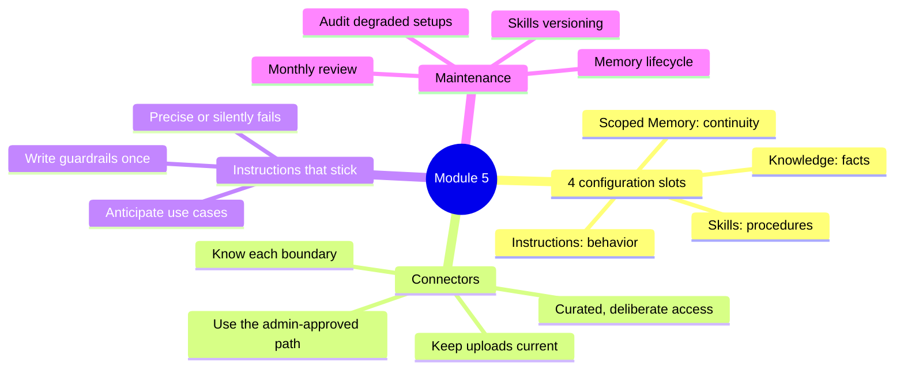
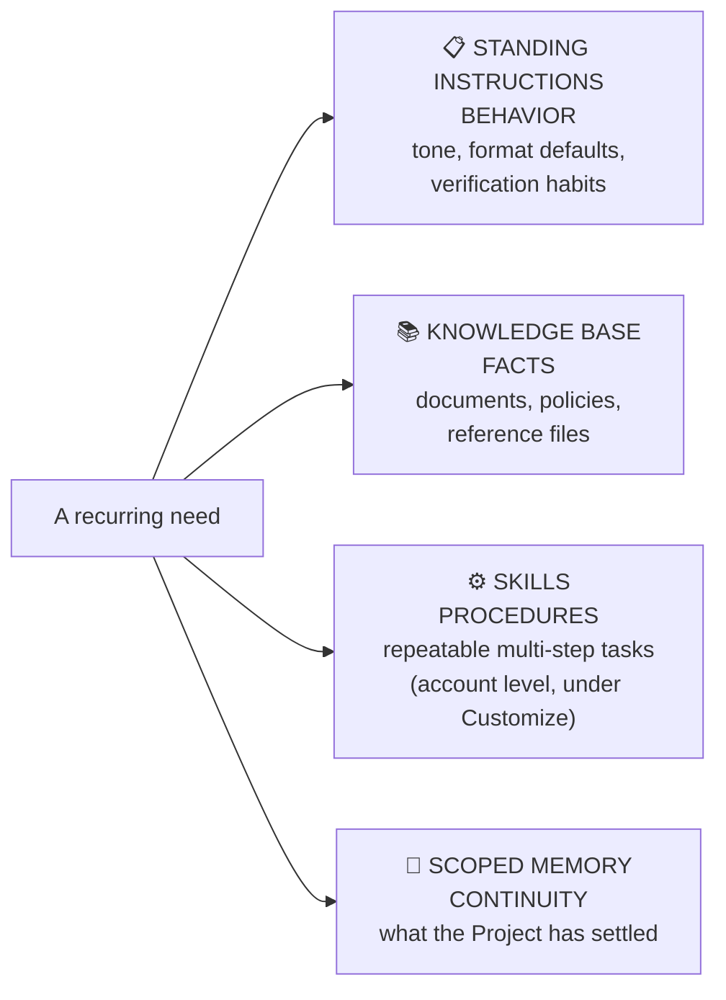
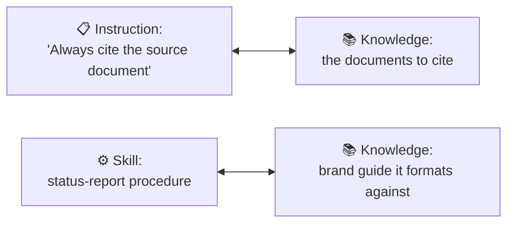
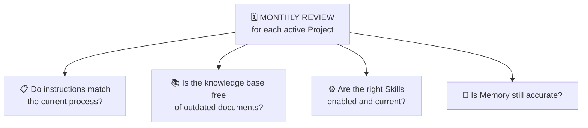

# 📕 Module 5: Configuration & Knowledge Management
### Last-minute revision notes for CCAO-F

> ⭐ **The big idea:** there's a line between **using** Claude (typing a good prompt today) and **operating** Claude (building an environment where the right context, instructions and procedures are **already in place**). **Configuration is leverage: set it up once, benefit in every conversation, then maintain it so it stays accurate.**

<!-- NOTES-START -->

## ⚡ 60-second recap

**Why configuration matters for teams:** when the Project, instructions and knowledge are curated, **two people asking the same question get the same quality of answer**. Without it, everyone re-creates context daily and **answers drift**.
**The second half is maintenance:** configurations **age**, and stale configuration **quietly degrades output**.

---

## 1. Configuring Claude Projects: the four slots

### Which slot? The recurring question
| Need | Example from the course | Slot |
|---|---|---|
| A rule about **behavior** | "Always cite sources" | **Standing instruction** |
| A **fact** Claude needs | "Our brand palette is these hex codes" | **Knowledge base** |
| A **multi-step procedure** | "Format findings into our standard report template" | **Skill** (built once at **account level under Customize**, reusable in **any** Project) |
| What the Project has **already settled** | Stakeholder names, standing preferences, earlier decisions | **Scoped Memory** |

⚠️ **The most common configuration mistake:** putting a **procedure in the instructions**, or a **behavior rule in the knowledge base**. It makes the Project harder to maintain.

**Memory vs. knowledge:** a **stable reference fact → knowledge**. An **evolving record of Project decisions → Memory**.

### "Scoped" is the key word
A Project's Memory is **kept separate from your other Projects**, so context from one client or workstream **never appears in another**. That isolation is what makes Memory **safe for sensitive or client-specific continuity**.

### Course example: one Project per client
| Slot | Client A's Project |
|---|---|
| **Standing instructions** | "Write in a formal register. Always cite the source document for any factual claim. Flag anything you are unsure of rather than guessing." |
| **Knowledge base** | Brand guide, current statement of work, the last three status reports |
| **Skill** (account-level, reused) | The firm's **status-report formatter**, so every weekly update has the same structure |
| **Scoped Memory** | Stakeholder names and standing preferences, which **never appear in Client B's Project** |

- On **Team or Enterprise**, the Project can be **shared with the engagement team under permissions**, so everyone works from the same baseline.
- **Project-scoped Memory** is what makes **one Project per client safe**.

### The pairing rule: some needs use two slots

**Neither half works alone.** The instruction has nothing to cite without the documents, and the documents get used inconsistently without the instruction. Ask **which slot**, and **whether it needs two slots working together**.

---

## 2. Connectors and uploaded knowledge

**Connectors** (e.g., **Google Drive, Gmail**) let Claude reach external systems **you authorize**: searching Drive, finding a relevant email. **You manage what's accessible.** Keep the set **deliberate**, rather than connecting everything by default.

### Capability boundaries
Each connector has a **defined boundary**. A mail connector **may search and read but not send**. Expecting an action it can't do gives a **confusing failure, not a clear error**, so **learn each boundary before building a workflow on it**.

### ⚠️ Two problems seen in real use
| Problem | What happens | Fix |
|---|---|---|
| **The wrong path to add a connector** | The obvious "add connector" path can lead to a **public directory** instead of your organization's **vetted connectors** | **Confirm the right path with your admin** (especially on Team or Enterprise) so you connect the **approved** source, not a look-alike |
| **Boundary confusion sends fixes to the wrong place** | Hitting a boundary can **look like a bug**, so reports go to the **wrong team** and the fix stalls *(reported from real use, not documented product behavior)* | Know where each connector's capability ends |

### Keep uploaded knowledge current
Treat it **like a shared drive**: **current, relevant, no duplicates**. **Three versions of the same policy invite Claude to cite the wrong one.** Remove old versions as you add new ones.

---

## 3. System-level instructions that stick

> Teams keep asking: *"Can we build the guardrails in once instead of retyping them?"* **Persistent (standing) instructions** do exactly that. Every conversation in the Project inherits them.

**① Write the guardrails once:** the most valuable instructions are the ones you'd otherwise **retype constantly**.
> *"Cite the source document for every factual claim, and say 'I don't know' rather than guessing when the documents do not cover something."*

**② Anticipate the use cases:** build in the **format, tone and guardrails before they're needed**. For client deliverables, set the preferred format and register up front, so first drafts land **closer to final**.

**③ Be precise, or it silently fails:** vague instructions **don't announce that they failed**. They just quietly don't work.

| ❌ Vague | ✅ Precise |
|---|---|
| "Be professional." | "Use a formal register, define any acronym on first use, and keep paragraphs under four sentences." |
| "Make the reports good and accurate." → quality varies, nothing changes | "For every figure in a report, state its source. If a figure is not in the provided data, mark it 'unverified' rather than including it. Lead each report with a one-sentence headline." → **consistent checking, and the headline every time** |

🧪 **The test:** *would two different people read the instruction the same way?*

---

## 4. Maintaining configurations

> Configurations are **living assets**. Instructions, knowledge, Skills and Memory all **go stale**, and stale configuration degrades output **quietly, with no error to warn you**.

🚨 **The sign you waited too long:** output quality **slipping for no visible reason**.

### Skills versioning
| Skill type | How it updates |
|---|---|
| **Anthropic-built** and **organization-provisioned** | **Automatically** |
| **Your own custom-uploaded** | **Only when you re-upload it** |

A Skill that silently produces a slightly wrong format every run is **a maintenance problem, not a prompting problem**.

### Memory lifecycle
Treat Memory **like a working file**: **review it** periodically, **edit or delete** stale entries, and **export a backup before a major change**. If outdated context has built up enough to mislead, a **full reset** is the right call. **Accuracy matters more than quantity.**
➕ **Configuration can be added to:** if Claude hasn't automatically captured something that matters (a constraint, a preference, background), **add it explicitly** to standing instructions or Memory instead of re-supplying it every session.

### Course example: auditing a degraded setup
A recurring report Project starts producing **subtly wrong output**. The maintenance checklist finds:

| Cause | Fix |
|---|---|
| A standing instruction references a metric **renamed last quarter** | **Update the instruction** |
| The knowledge base holds **two versions of the template** | **Remove the old template** |
| A Memory entry records a **stakeholder who has left** | **Delete the stale entry** |

👉 **The fix is maintenance, not a new prompt.** Output returns to standard **without changing how anyone prompts**.

---

## 🎯 Key takeaways (read these last)

1. **Configuration is leverage:** set it up once and benefit in every conversation. That's the difference between **operating** Claude and merely using it.
2. **Match each need to the right slot:** instructions → **behavior**, knowledge → **facts**, Skills → **procedures**, scoped Memory → **continuity**. Some needs **pair two slots**.
3. **Know each connector's boundary:** it prevents frustration and fixes going to the wrong team. Add connectors through the **admin-approved** path.
4. **Write instructions precisely:** vague ones fail silently. Precise, testable ones change the output every time.
5. **Maintain it or watch quality decay:** review instructions, knowledge, Skill versions and Memory on a schedule.

<!-- NOTES-END -->

---

# 📝 Question bank: 20 practice questions

> Answer all 20 first, then check the **answer key** at the end. *(Select TWO)* questions need both answers to count as correct.

**Q1.** What does the module mean by **operating** Claude rather than just **using** it?
- A. Using a more capable model
- B. Building an environment where the right context, instructions and procedures are already in place, so every conversation starts from a configured baseline
- C. Writing longer prompts
- D. Using Claude only through the API

**Q2.** Why does configuration turn individual skill into **team** capability?
- A. It makes Claude faster
- B. When the Project, instructions and knowledge are curated, two people asking the same question get the same quality of answer
- C. It removes the need for prompts
- D. It lets everyone use different models

**Q3.** *"Always flag anything you are unsure of rather than guessing"* belongs in:
- A. The knowledge base
- B. A Skill
- C. Standing instructions
- D. Scoped Memory

**Q4.** The company's approved list of product prices that Claude should refer to belongs in:
- A. Standing instructions
- B. The knowledge base
- C. A Skill
- D. A connector

**Q5.** A team wants every proposal to go through the same multi-step formatting procedure. Which mechanism fits, and where does it live?
- A. A standing instruction, inside the Project
- B. A knowledge-base document
- C. A Skill, built at the account level under Customize and reusable in any Project
- D. A Memory entry

**Q6.** Which is the **most common configuration mistake** named in the module?
- A. Using too many Projects
- B. Putting a procedure in the instructions, or a behavior rule in the knowledge base
- C. Turning on Memory
- D. Sharing a Project with the team

**Q7.** A Project records that "the client approved Option B in last week's discussion, and prefers summaries under one page." Where does this fit best?
- A. The knowledge base, since it's a fact
- B. Scoped Memory, since it's an evolving record of settled Project decisions and preferences
- C. A Skill
- D. Standing instructions in every Project

**Q8.** An analyst covers two competing companies and must keep each one's confidential assumptions isolated. What's the correct setup?
- A. One shared Project, with careful prompting
- B. A separate Project for each company, each with its own scoped Memory
- C. Turn Memory off completely
- D. Use a different model tier for each company

**Q9.** *(Select TWO.)* The instruction *"Always cite the source document for factual claims"* is in place, but there are no documents in the knowledge base. What does the module's **pairing rule** say?
- A. The instruction has nothing to cite without the documents
- B. The instruction works fine on its own
- C. Documents get used inconsistently without the instruction
- D. Knowledge bases make instructions unnecessary
- E. Pairing only applies to Skills

**Q10.** On Team or Enterprise plans, how can an engagement team all work from the same configured baseline?
- A. Each member copies the instructions into their own chats
- B. Share the Project with the team under permissions
- C. Use Incognito mode
- D. Email the knowledge files to each person

**Q11.** A user expects a mail connector to send emails, but it only searches and reads. What's the correct understanding?
- A. The connector is broken, so report a bug
- B. Each connector has a defined capability boundary, and sending is outside this one's
- C. A more capable model will enable sending
- D. Re-add it through the public directory

**Q12.** On a Team plan, what's the safest way to add a new connector?
- A. Use the first add-connector path you find
- B. Search the public directory for anything with the right name
- C. Confirm the correct path with your admin so you connect the approved, vetted source
- D. Connect every available connector by default

**Q13.** A knowledge base holds three versions of the same travel policy. What's the risk, and the fix?
- A. No risk; more documents help
- B. Claude may cite the wrong version; remove old versions and keep the knowledge base current with no duplicates
- C. Claude will merge them correctly
- D. Move all three into Memory

**Q14.** Which standing instruction is most likely to **actually change** the output?
- A. "Write high-quality summaries."
- B. "Be professional and clear."
- C. "Start with a one-sentence headline, use at most five bullets, and mark any figure not in the provided data as 'unverified'."
- D. "Do your best on every report."

**Q15.** What's the module's test for whether an instruction is precise enough?
- A. Whether it's longer than 50 words
- B. Whether two different people would read it the same way
- C. Whether Claude says it understood
- D. Whether it uses formal language

**Q16.** How often does the module suggest reviewing **active** Projects?
- A. Daily
- B. Monthly
- C. Once a year
- D. Only when an error message appears

**Q17.** *(Select TWO.)* Which statements about Skills versioning are correct?
- A. Anthropic-built and organization-provisioned Skills update automatically
- B. Custom-uploaded Skills update automatically every week
- C. Custom-uploaded Skills change only when you re-upload them
- D. Skills never change once created
- E. An out-of-date Skill producing a slightly wrong format is a prompting problem

**Q18.** *(Select TWO.)* Which are recommended parts of the Memory lifecycle?
- A. Export Memory as a backup before a major change
- B. Never delete entries, to keep history
- C. Do a full reset when outdated context has built up enough to mislead
- D. Store as many entries as possible
- E. Move Memory into the knowledge base monthly

**Q19.** Claude keeps missing an important constraint you've mentioned in several sessions. What does the module recommend?
- A. Keep mentioning it every session
- B. Add it explicitly to standing instructions or Memory
- C. Switch models
- D. Start using Incognito

**Q20.** A report Project's output has become subtly wrong with no error. The audit finds an instruction using a renamed metric, two template versions in the knowledge base, and a Memory entry naming a departed stakeholder. What's the fix?
- A. Write a new, more detailed prompt each time
- B. Switch to a more capable model
- C. Maintenance: update the instruction, remove the old template, delete the stale Memory entry
- D. Delete the whole Project and start over

---

# ✅ Answer key

| Q | Answer | Why (from the module) |
|---|---|---|
| 1 | **B** | Operating = a configured baseline, not a blank slate |
| 2 | **B** | A curated setup gives the same quality of answer for everyone. Without it, answers drift. |
| 3 | **C** | Behavior (a verification habit) → standing instructions |
| 4 | **B** | A fact or reference → knowledge base |
| 5 | **C** | A multi-step procedure → Skill, account-level under Customize |
| 6 | **B** | It makes the Project harder to maintain |
| 7 | **B** | Stable reference fact → knowledge. Evolving record of decisions → Memory. |
| 8 | **B** | Course quiz: separate Projects with scoped Memory. A shared Project risks leaking context; Memory off loses continuity; model tier has no effect on isolation. |
| 9 | **A, C** | "Neither works alone" |
| 10 | **B** | Share the Project under permissions on Team or Enterprise |
| 11 | **B** | A defined boundary, not a defect |
| 12 | **C** | The obvious path can lead to a public directory instead of your organization's vetted connectors |
| 13 | **B** | Curate it like a shared drive and remove old versions |
| 14 | **C** | Precise and testable. The others are vague and fail silently. |
| 15 | **B** | "Would two different people read it the same way?" |
| 16 | **B** | A monthly pass catches most drift |
| 17 | **A, C** | Auto-update for Anthropic and org Skills, re-upload for custom ones. A wrong format is a maintenance problem. |
| 18 | **A, C** | Review, edit or delete, export before big changes, reset if it misleads |
| 19 | **B** | Configuration can be added to: add it explicitly instead of re-supplying it |
| 20 | **C** | "The fix is maintenance, not a new prompt" |

**🎯 Score guide:** 18–20 ready · 14–17 re-read the sections you missed · below 14 go back through sections 1–4
