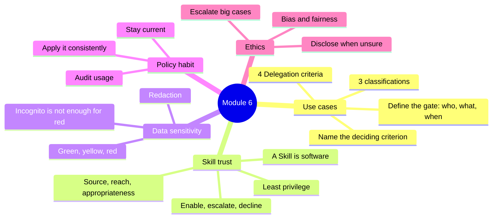
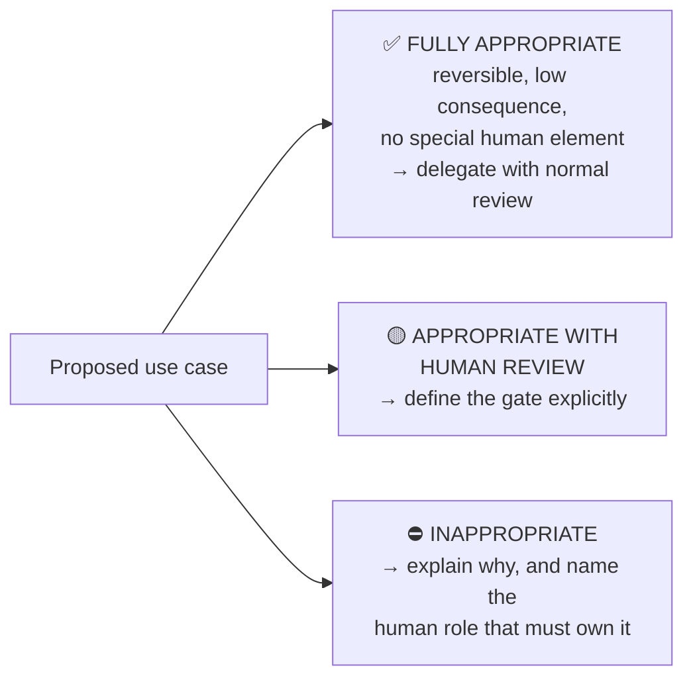
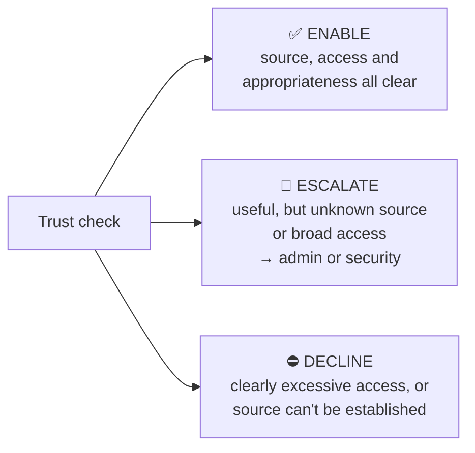
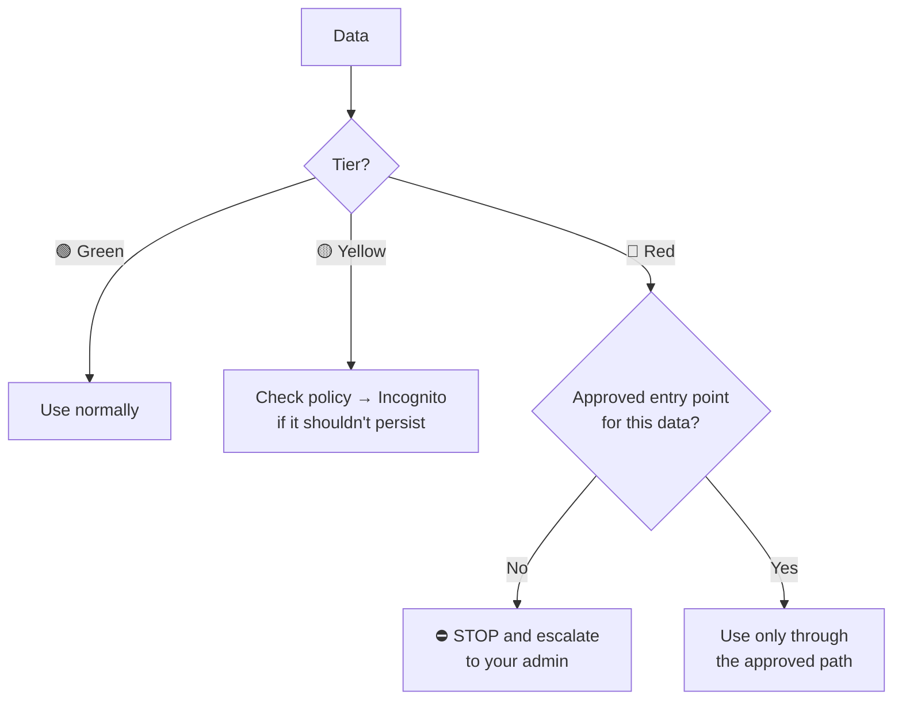

# 📓 Module 6: Governance, Risk & Responsible Use
### Last-minute revision notes for CCAO-F

> ⭐ **The big idea:** **one inappropriate use case can freeze an entire organization's AI program.** Governance is a **practitioner skill**: the policy sets the boundary, and **you decide in the moment** whether this use case, Skill or upload is appropriate.

<!-- NOTES-START -->

## ⚡ 60-second recap

**Two AI Fluency competencies:** **Diligence** = ownership and verification. **Delegation** = the criteria for judging whether a use case is appropriate at all.

---

## 1. Appropriate vs. inappropriate use cases

Deciding is a **structured evaluation, not a gut feeling**. Screen every use case with **four Delegation criteria**:

| Criterion | The question to ask |
|---|---|
| **Reversibility** | Can a wrong output be caught and undone **before it causes harm**? |
| **Consequence of error** | What does it cost if the output is wrong? |
| **Need for human creativity or empathy** | Does it need judgment, relationship or care that AI can't supply? |
| **Accountability** | Who answers for the outcome, and can they exercise that over an AI result? |

### The criteria interact, so name the one that decides it
- **Not a checklist where one failure ends it.** A **client condolence note** is low-stakes and reversible, but **the relationship means a person owns it**. A **financial summary** is high-consequence, but **appropriate if a named reviewer signs off first**.
- **Accountability can't be transferred to a model.**
- 👉 Run all four, then name the **deciding criterion** *(the course calls it "load-bearing")*: **the one that would change the classification if it changed.** That makes your call **defensible to a risk or compliance reviewer**.

### The three classifications (write down your reasons)

### 🚪 The gate IS the classification
"Appropriate with human review" is **the one people most often get wrong**. They stop at the label and **never define the gate**.

| A defined gate states… | Meaning |
|---|---|
| **WHO** reviews | The role **with the accountability**, not whoever is free |
| **WHAT** they check | The **specific risk**: factual accuracy, fairness, policy compliance |
| **WHEN** | **Before** the output is used, not after |

✅ *"A manager reviews the shortlist for adverse-impact patterns before any candidate is contacted."*
❌ *"We will keep a human in the loop."*
**If you can't state the gate as who, what and when, the use case isn't ready to run.**

### Course example: a set of use cases
| Use case | Classification | Why |
|---|---|---|
| Internal FAQ drafted from approved policy documents | ✅ Fully appropriate | Reversible, low stakes, factual grounding available |
| Summarize CVs into a shortlist | 🟡 With human review **+ bias safeguards** | Consequential, fairness-sensitive. **The hiring manager owns the selection.** |
| A final medical or legal determination | ⛔ Inappropriate | Irreversible, and professional accountability can't transfer |
| Draft replies to billing complaints *(the borderline case)* | 🟡 With human review | **Deciding criterion: accountability** (the company owns what it tells a customer about their money). **Gate:** a support agent checks each draft against the account record and adjusts the tone before sending. |

💬 *"It feels risky"* doesn't hold up. *"Irreversible + accountability can't transfer"* does.

---

## 2. Skill trust and feature-level risk

> **A Skill is software.** It can access what Claude can in a session and **act through code execution**. The answer is a **repeatable trust check before enabling**, not blind trust or blanket bans.

| Check | Question |
|---|---|
| **Source** | Who published it? **Anthropic-provided or internally approved = lower risk.** An unknown third party needs more scrutiny. |
| **Reach** | ⚠️ **Skills don't request permissions. They inherit the session's access.** Is what it could reach **in proportion to the task**? **Check the bundle** (instructions, dependencies, files). *A formatting Skill whose instructions go beyond formatting is a red flag.* |
| **Appropriateness** | Is it the right tool at all, or **more capability than the job needs**? |

**"Internal" doesn't mean "checked":** another team's Skill may have broad access or be built against an **older policy**. **Confirm with its publisher what it accesses and why**, and check it against **current policy**.

### Three possible outcomes of a trust check

Failing means **don't enable it on your own authority**, not always "never". *Course example:* Anthropic document formatter → **enable**. Unknown third-party "analytics booster" wanting broad access → **organizational review first**.

**Least privilege (for any feature: connectors, tools, integrations):** *who provides it, what does it access, is that in proportion to the need?* **Grant the narrowest access that gets the job done, and revisit it when the job changes.**

---

## 3. Data sensitivity, privacy and feature controls

> **Know the data's sensitivity before it goes into any feature.** Classify first, then choose the control.

| Tier | Examples | Handling |
|---|---|---|
| 🟢 **Green: safe to use** | Published material, anonymized or aggregated data, internal documents already cleared for wide sharing | No special control |
| 🟡 **Yellow: review first** | Internal documents not meant to leave the company, anything with **names or contact details**, drafts tied to an **unannounced** deal or product | Check against policy. **Incognito** if it shouldn't persist. |
| 🔴 **Red: keep out unless an approved path exists** | **Regulated** data (health, financial, government), **credentials and secrets**, anything under a **third-party confidentiality obligation** | **Confirm an approved entry point before anything is uploaded** |

**Unsure between two tiers? Treat it as the more sensitive one.**

### Redaction and anonymization
Remove sensitive details the **task doesn't need** (e.g., "Customer 1, Customer 2" for trend analysis). ⚠️ **Two ways it fails:**
1. **Partial redaction:** a leftover **account number, rare job title or specific date** can still identify someone.
2. **Breaking the task:** if the work **needs** the specifics, find an **approved path** or keep it out. **Redaction doesn't make any data safe.**

### Feature controls
| Control | What to know |
|---|---|
| **Code execution sandbox** | Uploaded files are processed there. **Check what you upload before running the analysis.** |
| **Memory persistence** | It carries information across sessions, which may be exactly what you **don't** want for sensitive work |
| **Incognito** | Keeps the session **out of history and Memory**, but it **still follows your organization's data-retention policies** and can appear in **organizational data exports** |
| **Org-level Memory controls** | **Team: no org-level Memory controls.** **Enterprise: Owners and Primary Owners** control it, including **disabling Memory for the whole organization**. |

> ❗ **Incognito does NOT make red data safe.** It controls **whether something is remembered**, not **whether the data was allowed there in the first place**. For regulated data, **"is this allowed here?" comes before "how do I handle it here?"**

**Course examples:** anonymized survey data → 🟢 · confidential M&A document → 🟡 policy check + Incognito · customer personal-data spreadsheet → **redact**, or keep it out and confirm the approved path · **patient records → 🔴 stop and escalate**. *Entry points may handle retention differently, so ask when in doubt.*

---

## 4. Organizational policy: Diligence as a habit

> *A policy followed only when someone is watching isn't governance.* **The gap between policy and practice is where the risk is.**

- **Apply it consistently**, especially on **routine, low-visibility decisions**, where drift builds up.
- **Audit usage against policy.** Any difference is a **Diligence gap** to close.
- **Stay current:** **policy updates and new features** can make last quarter's practice non-compliant.

**Course example: a monthly usage audit**
| Gap found | Habit-level fix |
|---|---|
| Unreleased product spec uploaded to a **non-approved entry point** | Reminder about **approved entry points** |
| A Skill enabled **without a source check** | **Skill-vetting step** added to Project setup |
| Client report **skipped its review gate twice** under deadline pressure | **Non-negotiable review gate** on client deliverables |

**Not malicious, just drift.**

---

## 5. Ethics: bias, fairness, transparency

> **Ethical risk hides in ordinary outputs.** Check it as part of **routine review**, not a separate exercise.

- **Bias** comes from the **prompt, the framing, or patterns in generated language**. Check fairness in people-facing work (**hiring, evaluations, communications to particular groups**). **Risk is highest where stakes for individuals are highest.**
- **Disclosure:** some settings and policies require disclosing AI assistance. **When unsure, disclose rather than conceal.**
- **Ambiguous cases:** **who's affected → what could go wrong → what's fair → what disclosure**, then **write the reasoning down**.
- **Escalate** when the **affected group is large**, the **potential harm is significant**, or the question is **beyond your team's authority** → your AI governance or ethics function. **Bring your documented reasoning, not a verdict.**

**Course example:** **performance-review summaries** drafted from a manager's notes → **appropriate with human review and a fairness check** (each summary checked against the notes, with a consistent standard, and disclosure possibly needed). **The reasoning, not just the verdict, makes it defensible.**

---

## 🎯 Key takeaways (read these last)

1. **Governance is a practitioner skill**, exercised one decision at a time by you.
2. **Screen use cases with the Delegation criteria** (reversibility, consequence, human element, accountability) → appropriate, appropriate **with a defined who/what/when gate**, or inappropriate.
3. **A Skill is software:** check source, reach and appropriateness before enabling → **enable, escalate or decline**.
4. **Know the data's sensitivity before it enters a feature:** green, yellow or red. **Incognito doesn't make red data safe.**
5. **Ethical risk hides in ordinary outputs:** check bias and fairness, disclose when unsure, and escalate big cases with your reasoning.

<!-- NOTES-END -->

---

# 📝 Question bank: 20 practice questions

> Answer all 20 first, then check the **answer key** at the end. *(Select TWO)* questions need both answers to count as correct.

**Q1.** According to the module, who actually exercises governance?
- A. The policy document
- B. The practitioner, one decision at a time
- C. Only the legal team
- D. Anthropic

**Q2.** *(Select TWO.)* Which are among the four Delegation criteria for screening a use case?
- A. Need for human creativity or empathy
- B. Prompt length
- C. Consequence of error
- D. Which model tier is used
- E. How quickly the output is produced

**Q3.** Drafting a condolence note to a long-standing client is low-stakes and fully reversible. What does the module conclude?
- A. Fully appropriate; delegate it completely
- B. A person should own it, because the relationship element matters
- C. Inappropriate in all cases
- D. Use a more capable model

**Q4.** What's the "load-bearing" (deciding) criterion?
- A. The criterion with the highest score
- B. The criterion that, if it changed, would move the use case into a different classification
- C. Always reversibility
- D. The criterion the manager prefers

**Q5.** Which is a **properly defined** human-review gate?
- A. "We'll keep a human in the loop."
- B. "Someone will check it when they have time."
- C. "The finance lead checks every figure against the ledger before the summary is shared with the board."
- D. "Claude will review its own output."

**Q6.** A team proposes having Claude issue **final, unreviewed** insurance claim decisions. How should this be classified?
- A. Fully appropriate
- B. Appropriate with light review
- C. Inappropriate: irreversible consequence and accountability that can't transfer
- D. Appropriate if Opus is used

**Q7.** Claude drafts replies to customer billing complaints. Which classification and deciding criterion does the course give?
- A. Fully appropriate; reversibility
- B. Appropriate with human review; accountability, since the company owns what it tells a customer about their money
- C. Inappropriate; need for empathy
- D. Appropriate with human review; prompt quality

**Q8.** Which statement about Skills and permissions is correct?
- A. Skills request only the permissions their task needs
- B. Skills don't request permissions; they inherit whatever access the session already has
- C. Skills can't access any data
- D. Skills are safe once a colleague recommends them

**Q9.** A Skill built by **another team inside your organization** is offered to you. What's the right approach?
- A. Enable it; internal means checked
- B. Treat it like software from a sister department: confirm with its publisher what it accesses and why, and that it matches current policy, before enabling it on your data
- C. Decline all internal Skills
- D. Enable it and monitor for a week

**Q10.** A useful-looking Skill has an unknown publisher and seems to have broad reach. Which outcome fits best?
- A. Enable
- B. Escalate to your admin or security function for review
- C. Decline permanently without review
- D. Enable it in Incognito

**Q11.** What does the principle of **least privilege** mean here?
- A. Give every feature full access so nothing breaks
- B. Grant the narrowest access that gets the job done, and revisit it when the job changes
- C. Use only the cheapest model
- D. Never use connectors

**Q12.** A spreadsheet contains employee names and personal email addresses, and isn't meant to leave the company. Which tier is it?
- A. Green
- B. Yellow
- C. Red
- D. No tier is needed

**Q13.** You're unsure whether a dataset is yellow or red. What should you do?
- A. Treat it as yellow to save time
- B. Treat it as the more sensitive tier until you can confirm otherwise
- C. Upload it and decide later
- D. Use Incognito, which makes it safe either way

**Q14.** You remove customer names from a file, but leave account numbers and exact sign-up dates in a small customer base. What's the issue?
- A. No issue; names were removed
- B. Partial redaction: the remaining fields can still identify people
- C. The redaction broke the task
- D. The file is now red

**Q15.** *(Select TWO.)* Which statements about Incognito are correct?
- A. It keeps the session out of chat history and Memory
- B. It overrides your organization's data-retention policy
- C. It still follows your organization's data-retention policies and can appear in organizational data exports
- D. It makes regulated data safe to upload anywhere
- E. It's the same control as an approved entry point

**Q16.** Patient health records need summarizing, and your organization hasn't confirmed an approved, compliant path for health data. What's the correct action?
- A. Use Incognito and continue
- B. Redact the names and continue
- C. Stop and escalate to your admin. For regulated data, "is this allowed here?" comes first.
- D. Use a more capable model

**Q17.** Who controls organization-wide Memory settings, including disabling Memory for the organization?
- A. Any Team plan member
- B. On Enterprise, Owners and Primary Owners (Team plans have no org-level Memory controls)
- C. Anthropic only
- D. Each Project's creator

**Q18.** A monthly audit finds a review gate on client reports was skipped twice under deadline pressure. What's the right response?
- A. Ignore it, since nothing went wrong
- B. Discipline the individuals and move on
- C. Treat it as drift, a Diligence gap, and make the review gate non-negotiable for client deliverables
- D. Ban Claude for the team

**Q19.** A recruiter forwards Claude's résumé shortlist as "the candidates who qualified", and no one reviews who was excluded. Which concern is **most directly** raised?
- A. Disclosure
- B. Bias: systematic disadvantage in the exclusions can go undetected
- C. Intellectual property
- D. Accountability has passed to Claude

**Q20.** *(Select TWO.)* An ethical question affects a large population and touches areas your team has no authority to resolve. What should you do?
- A. Decide alone to avoid delays
- B. Escalate to your organization's AI governance or ethics function
- C. Bring your documented reasoning rather than just a verdict
- D. Ask Claude to make the final ethical decision
- E. Skip disclosure to keep it simple

---

# ✅ Answer key

| Q | Answer | Why (from the module) |
|---|---|---|
| 1 | **B** | Governance is a practitioner skill, not a policy binder |
| 2 | **A, C** | Reversibility, consequence of error, need for human creativity or empathy, accountability |
| 3 | **B** | The criteria interact: low-stakes and reversible, but the relationship means a person owns it |
| 4 | **B** | The criterion that would change the classification if it changed |
| 5 | **C** | It states who, what and when (before use) |
| 6 | **C** | Course quiz: irreversibility plus accountability that can't transfer |
| 7 | **B** | Course borderline case: the deciding criterion is accountability, with a defined agent gate |
| 8 | **B** | No permission list. A Skill inherits the session's full access. |
| 9 | **B** | Internal doesn't mean checked |
| 10 | **B** | Escalate when it's useful but the source is unknown or the reach is broad |
| 11 | **B** | Narrowest access, revisited when the job changes |
| 12 | **B** | Names or contact details + internal-only → yellow |
| 13 | **B** | Default to the more sensitive tier |
| 14 | **B** | Partial redaction can still identify people, especially in small groups |
| 15 | **A, C** | Memory exclusion and data retention are separate controls |
| 16 | **C** | Incognito doesn't make red data safe |
| 17 | **B** | Team has no org-level Memory controls. Enterprise Owners and Primary Owners do. |
| 18 | **C** | Drift, not malice. Fix it with a habit-level control. |
| 19 | **B** | Course quiz: bias in unreviewed exclusions. Accountability can't pass to a tool. |
| 20 | **B, C** | Escalate with documented reasoning |

**🎯 Score guide:** 18–20 ready · 14–17 re-read the sections you missed · below 14 go back through sections 1–5
