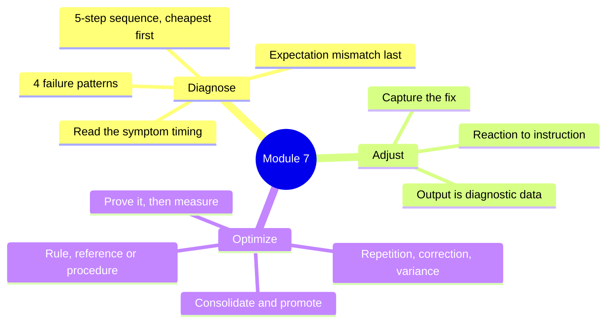
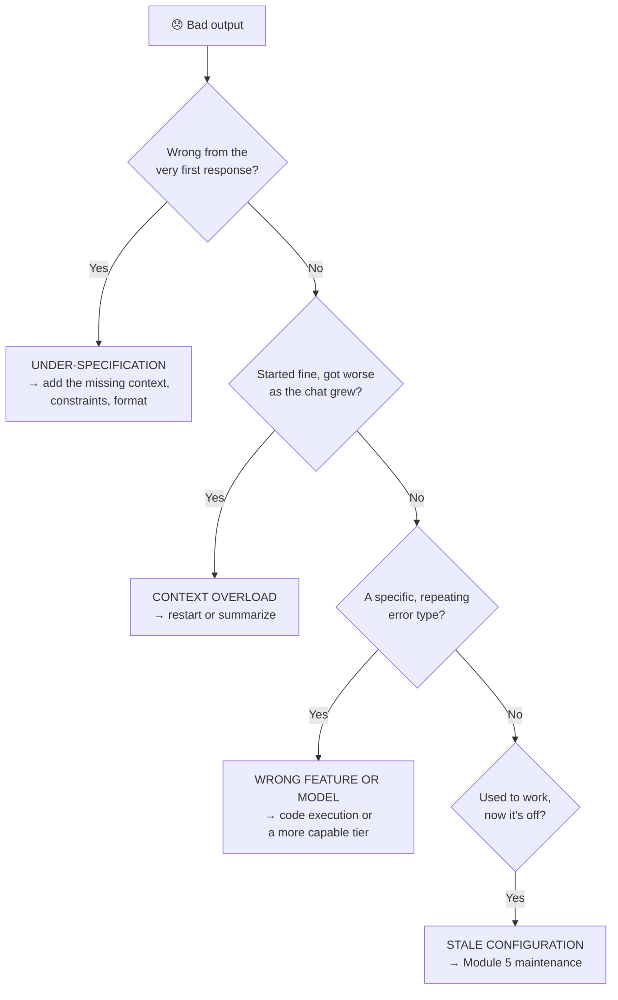
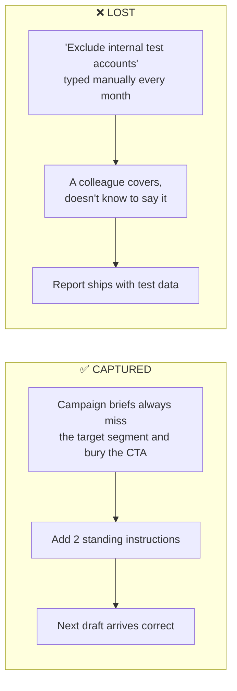

# 📔 Module 7: Troubleshooting & Optimization
### Last-minute revision notes for CCAO-F

> ⭐ **The big idea:** when an output disappoints, most people either **give up** ("Claude can't do this") or **thrash** (changing random things until something works). **Diagnostic skill replaces both with a sequence.** Underperformance has **causes you can find**, and the sequence usually turns a dead end into a **five-minute fix**.

<!-- NOTES-START -->

## ⚡ 60-second recap

---

## 1. Four failure patterns: read the timing

They all produce **similar-looking bad output**, so the skill is reading **when and how** the symptom shows up.

| Symptom timing | Root cause | What's happening | Fix |
|---|---|---|---|
| 🥇 **Wrong from the first response** | **Under-specification** | The prompt left out context, constraints or format. **The most common cause, and the cheapest to fix.** | **Add what was missing** |
| 📉 **Got worse over time** | **Context overload** | A long chat neared the limit, earlier content was **summarized**, and early instructions **lost force** | **Restart or summarize**, not a better prompt |
| 🎯 **A specific, repeating type of error** | **Wrong feature or model** | **Numbers subtly off** (needs code execution) or **shallow analysis** from a **speed-tier** model | **The right tool**, not more prompting |
| 🕰️ **"It used to work"** | **Stale configuration** | An instruction, knowledge source or Skill **drifted out of date**, silently | **Maintenance** (Module 5) |

### Isolate before you fix
Before blaming the tool, **locate the failure**: is it the **prompt** (specification), the **context** (window full or the wrong material loaded), the **feature choice** (wrong entry point, model, or no code execution), or an **expectation mismatch** (a task Claude could never do well)? **Naming the cause points straight to the fix.**

---

## 2. The diagnostic sequence: cheapest fix first

**Why this order?** Re-reading the prompt takes **seconds** and fixes the **most common** failure. A restart costs a little more. Switching feature or model and checking configuration cost more again. **"The task isn't a fit" is the most expensive conclusion** (it ends the attempt), so it comes **last**.

⚠️ **Most people get this backwards.** They jump straight to **"switch to the most capable model"** or **"this is impossible"**. **The discipline is resisting the urge to skip to step 5.**

### Course examples: what went wrong, and the fix
| Complaint | Diagnosis | Fix |
|---|---|---|
| "The summary keeps missing key points." | **Under-specification** | Define what "key" means |
| "It stopped following my format halfway through." | **Context overload** | Restart from a summary, or **put the format in a standing instruction** |
| "The numbers are subtly wrong." | **Wrong feature** | Move the calculation to **code execution** |
| "It worked last month, now it's off." | **Stale configuration** | Run the **Module 5 maintenance checklist** |
| "I asked it to predict next quarter's **exact** sales and it was wrong." | **Expectation mismatch** (step 5) | **Reshape the task:** a **range with stated assumptions**, or **a model of the drivers** you can adjust |

🧠 **Spotting a genuine mismatch is a skill too.** It stops you wasting time tuning a prompt for an output that was **never possible**.
✅ The sequence takes **a minute or two** and ends in either **a specific, cheap fix** (usually) or **a confident, reasoned "this task needs reshaping"** (occasionally). **Both are wins.**

---

## 3. Adjusting your approach from feedback

> **Every disappointing output is diagnostic data.** Fixing the same problem by hand every time is a missed opportunity.

**Build feedback loops into recurring work:** after each round, ask *what did this output reveal about the system that produced it?* A report needing the **same correction every week** is telling you the prompt, context or configuration is **missing something**.

### Turn a reaction into an instruction
| ❌ Reaction (how it feels) | ✅ Instruction (what to change) |
|---|---|
| "Too generic" | "Name the audience and the one action I want them to take" / "add the audience to the context" |
| "Wrong tone" | "Add a tone constraint to the standing instruction" |
| "Missed the point" | "State the single question the output must answer, up front" |

🔑 **Ask:** *what would have to be there for this to be right, and **which lever** controls it?* (the prompt, the loaded context, or a configuration setting). **If you can't name the lever, it's still a reaction, and the next attempt is a guess.**

### Capture what worked
- A phrasing that works reliably → **standing instruction**. A multi-step fix → **Skill**.
- 💸 **The expensive mistake is finding the fix and then losing it.** Uncaptured fixes get **rediscovered every cycle, by every person**. Capturing once turns **a repeated cost into a one-time cost**.
- **The test:** *will this same correction be needed again, by me or someone else?* **Yes → it belongs in configuration.**
- **Memory** may pick up patterns you repeat, but it's **per-user and best-effort**. **Configuration is the deliberate, shared, reliable home for a fix.**

---

## 4. Optimizing workflows

> **Optimization is deliberate:** **watch the workflow closely → find the friction → move the fix into configuration → measure it.** Done well, the gains **add up** for everyone.

### Find the friction
Friction is **easy to live with and hard to see**. **Watch one full cycle and write down every manual step you also did last time.** That list is your **optimization backlog**.

| Signal | What it looks like | Fix |
|---|---|---|
| **Repetition** | You paste or type the same thing every run | **Saved context or a standing instruction** |
| **Correction** | You fix the same flaw in every output | **A configuration change** so it stops appearing |
| **Variance** | Different people get different results | **A shared Skill or knowledge base** |

### Consolidate and promote
- **Consolidate:** combine steps that can run together, instead of separate prompts.
- **Promote:** move repeated patterns into **Projects and Skills**. *Promotion is how a personal workaround becomes a team-wide efficiency.*

**Put it in the right place: is it a rule, a reference or a procedure?**

| Type | Goes to | Example |
|---|---|---|
| **Rule** | **Standing instruction** | "Always include the target segment" |
| **Reference** | **Knowledge base** | Brand voice guide, current product list |
| **Procedure** | **Skill** | "Generate the weekly report in this exact format and order" |

⚠️ Putting it in the wrong place is why some "optimizations" **don't stick**: a procedure squeezed into a one-line instruction **loses its steps**, and reference material crammed into an instruction **bloats every prompt**.

**Promote with caution:** run a **few cycles with the old approach still available** before relying fully on the new setup. **Prove the gain, then commit.** A bad change built into a shared workflow **does damage every cycle**.

### Measure the improvement
- Track **time saved per cycle**, **fewer revision rounds**, and **consistency across people** (e.g., 40 → 25 minutes, 3 rounds → 1).
- **Choose the metric that matches why the workflow matters:** customer-facing report → **consistency and accuracy**. Internal draft → **time**.
- The right metric also tells you **when to stop**. Past "good enough", more tuning is **friction of its own**.

### Course example: workflow audit, 45 → 25 minutes
| Friction | Type | Promoted to |
|---|---|---|
| Each analyst re-pastes the same background | Reference | **Shared Project knowledge base** |
| Each reformats the output by hand | Procedure | **Skill** for the report format |
| Each catches different things | Rule | **Standing instruction** for the verification step |

**Result:** about **25 minutes** per analyst, a **consistent format** across the team, and **one fewer revision round**.

---

## 🎯 Key takeaways (read these last)

1. **Underperformance has causes you can find:** run the sequence (**specification → context → feature/model → configuration → fit**) before blaming the tool.
2. **Isolate before you fix:** prompt, context, feature choice or expectation mismatch. **The timing of the symptom tells you which.**
3. **Every disappointing output is data:** turn the reaction into an instruction, then **capture the fix** as an instruction or Skill so it lasts.
4. **Optimize deliberately:** find the friction (repetition, correction, variance), **promote** it to the right place (rule → instruction, reference → knowledge, procedure → Skill), and **measure** the gain.

<!-- NOTES-END -->

---

# 📝 Question bank: 20 practice questions

> Answer all 20 first, then check the **answer key** at the end. *(Select TWO)* questions need both answers to count as correct.

**Q1.** According to the module, what are the two unproductive reactions to a disappointing output?
- A. Diagnosing and fixing
- B. Giving up ("Claude can't do this") and thrashing (changing random things)
- C. Restarting and summarizing
- D. Measuring and promoting

**Q2.** In a brand-new chat, Claude's **very first** draft of a client update is generic and ignores the two deadlines you care about. What's the most likely root cause?
- A. Context overload
- B. Stale configuration
- C. Under-specification
- D. Wrong model tier

**Q3.** A long session started well, but after two hours Claude stops following the table format you set at the start. What's the diagnosis and the fix?
- A. Under-specification; rewrite the original prompt
- B. Context overload; restart from a summary or put the format in a standing instruction
- C. Wrong feature; use code execution
- D. Stale configuration; run maintenance

**Q4.** Claude's totals in a budget summary are **subtly off** every time. Which pattern is this?
- A. Under-specification
- B. Context overload
- C. Wrong feature; move the calculation to code execution
- D. Expectation mismatch

**Q5.** A Project that produced excellent reports last month now produces off-target ones, and no one changed how they prompt. What's the diagnosis?
- A. Under-specification
- B. Stale configuration; run the Module 5 maintenance checklist
- C. Context overload
- D. The task isn't a fit

**Q6.** You asked for a deep competitive analysis using a **fast, lightweight model tier**. The output stays shallow even after you add detail. What's the fix?
- A. Keep adding more context
- B. Switch to a more capable model built for deep analysis
- C. Restart from a summary
- D. Update the knowledge base

**Q7.** What's the correct order of the diagnostic sequence?
- A. Question fit → model → prompt → context → configuration
- B. Prompt → context → feature/model → configuration → question fit
- C. Configuration → prompt → fit → context → model
- D. Model → configuration → context → prompt → fit

**Q8.** Why is "question whether the task fits at all" the **last** step?
- A. It's the least important
- B. It's the most expensive conclusion, ending the attempt, so you only reach it after ruling out cheaper causes
- C. Claude can do every task
- D. It requires admin approval

**Q9.** *(Select TWO.)* Which are among the module's four places to look when isolating a failure?
- A. The prompt (specification)
- B. The user's typing speed
- C. Expectation mismatch
- D. The browser being used
- E. The time of day

**Q10.** A manager asks Claude for next year's **exact** revenue figure, gets a wrong number, and keeps rewording the prompt. What does the module recommend?
- A. Keep tuning the prompt
- B. Switch to the most capable model
- C. Recognize an expectation mismatch and reshape the task: ask for a range with stated assumptions, or a model of the drivers
- D. Use Incognito

**Q11.** Which is a properly translated **instruction** rather than a **reaction**?
- A. "This isn't quite right."
- B. "Make it better."
- C. "State the single question the output must answer, up front."
- D. "It missed the point."

**Q12.** What's the module's test for whether a fix should be promoted into configuration?
- A. Whether it took longer than 10 minutes to find
- B. Whether the same correction will be needed again, by you or someone else
- C. Whether Claude agrees
- D. Whether it uses code execution

**Q13.** Why isn't relying on Memory enough to capture a team fix?
- A. Memory is shared with every team automatically
- B. Memory is per-user and best-effort; configuration is the deliberate, shared, reliable home
- C. Memory can't store text
- D. Memory deletes itself weekly

**Q14.** An analyst types "exclude internal test accounts" every month. While they're on leave, a colleague runs the report and it ships with test data. What was the real failure?
- A. The model tier
- B. Leaving a known fix uncaptured in one-off conversations
- C. Context overload
- D. The colleague's prompt length

**Q15.** *(Select TWO.)* Match each friction signal to its fix correctly:
- A. Repetition → saved context or a standing instruction
- B. Variance → switch models
- C. Variance → a shared Skill or knowledge base
- D. Correction → do it by hand more carefully
- E. Repetition → start a new chat each time

**Q16.** Where should "our current product list" go when you promote it?
- A. Standing instruction
- B. Knowledge base
- C. Skill
- D. Memory

**Q17.** A multi-step procedure for producing the weekly report was squeezed into a one-line standing instruction, and the results are inconsistent. What went wrong?
- A. Nothing; instructions are always best
- B. Wrong place: a procedure belongs in a Skill; as a one-line instruction it loses its steps
- C. It should have gone in Memory
- D. The model tier is too low

**Q18.** Before fully relying on a newly promoted configuration change, what does the module advise?
- A. Roll it out to everyone immediately
- B. Run a few cycles with the old approach still available, prove the gain, then commit
- C. Never change configuration
- D. Ask Claude whether it's better

**Q19.** For a **customer-facing** report workflow, which metric matters most?
- A. Raw speed only
- B. Consistency and accuracy
- C. Number of prompts sent
- D. Model tier used

**Q20.** A monthly close report has reliable numbers, but three analysts format their sections differently, and a reviewer spends 90 minutes reconciling them. Which optimization best cuts that 90 minutes?
- A. Upgrade the model tier so sections are drafted faster
- B. One shared Skill that formats every section to a single template
- C. Ask analysts to start earlier
- D. Add a second reviewer

---

# ✅ Answer key

| Q | Answer | Why (from the module) |
|---|---|---|
| 1 | **B** | Diagnostic skill replaces giving up and thrashing with a sequence |
| 2 | **C** | Wrong from the first response in a fresh chat = under-specification |
| 3 | **B** | Got worse over time = context overload. Restart, summarize, or put the format in an instruction. |
| 4 | **C** | A specific, repeating error type: numbers need code execution |
| 5 | **B** | "Used to work" = stale configuration |
| 6 | **B** | Course quiz: more context can't add depth a lightweight tier can't produce |
| 7 | **B** | Cheapest fix first |
| 8 | **B** | The most expensive conclusion comes last. Resist skipping to step 5. |
| 9 | **A, C** | Prompt, context, feature choice, expectation mismatch |
| 10 | **C** | Course example: reshape into a range with assumptions, or a model of the drivers |
| 11 | **C** | It names a specific lever, so it's an instruction |
| 12 | **B** | Needed again → it belongs in configuration |
| 13 | **B** | Memory is per-user and best-effort |
| 14 | **B** | "The fix existed the whole time; the failure was leaving it un-captured" |
| 15 | **A, C** | Repetition → saved context or instruction. Correction → configuration change. Variance → shared Skill or knowledge base. |
| 16 | **B** | A reference → knowledge base |
| 17 | **B** | Wrong place: procedures go in Skills |
| 18 | **B** | Prove the gain on a few runs, then commit |
| 19 | **B** | Match the metric to why the workflow matters |
| 20 | **B** | Course quiz: target the measured bottleneck (formatting inconsistency), not general speed |

**🎯 Score guide:** 18–20 ready · 14–17 re-read the sections you missed · below 14 go back through sections 1–4
